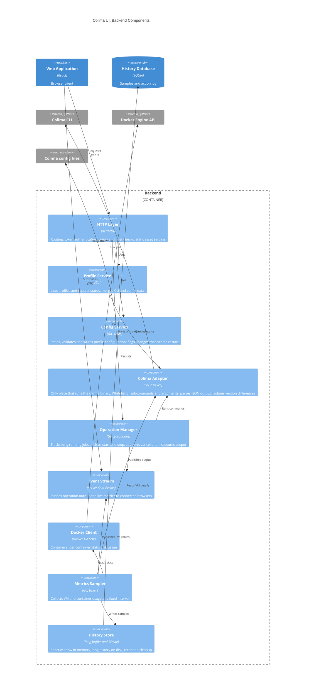

# Colima UI: C4 Architecture Documentation

Status: Draft 0.2, 22 November 2026 (adds the frontend styling and UI library decisions)
Scope: Levels 1 to 3 of the C4 model (Context, Containers, Components). Level 4 (code) is intentionally left out until the first implementation exists.

## 1. Purpose

Colima UI is a local web interface on top of Colima. Colima is a command line tool that runs a Lima virtual machine and a container runtime inside it. The UI has two goals. The first is to make the VM layer easier to operate: profiles, start, stop, restart, and configuration. The second is to make capacity and limits visible, so the user can see what the VM is allocated, what it actually uses, and which containers are responsible.

The tool runs only on the developer's own machine. It is not a hosted service and it has no multi user concerns.

## 2. Level 1: System Context

The developer opens the UI in a browser. The UI does not manage containers or VMs by itself. It delegates to Colima for the VM lifecycle and to the Docker Engine API for container and usage details.


## 3. Level 2: Containers

In C4, a container is a separately running piece of the system, not a Docker container. Colima UI has three: the React single page application, the Go backend, and a SQLite database file. The backend serves the built frontend from embedded assets, so the whole product ships as one binary.


### Container responsibilities

| Container | Technology | Responsibility |
| --- | --- | --- |
| Web Application | React, Tailwind CSS, shadcn/ui (Radix primitives), built to static files | Presents state, sends user intent to the API, shows streamed progress. Holds no business rules beyond input validation for convenience. |
| Backend | Go, standard library HTTP, Docker Go SDK | Owns every interaction with the machine. Validates requests, runs Colima commands, streams output, samples metrics, enforces security rules. |
| History Database | SQLite through a pure Go driver (modernc.org/sqlite), no cgo | Stores time series samples and an action log so history survives restarts. |

### Source of truth

Current state is always read live from Colima, the config files and the Docker API. The database is never used to answer "what is the state right now". This avoids drift when the user runs Colima from a terminal while the UI is open.

## 4. Level 3: Components of the Backend



### Component notes

The HTTP Layer is thin. It decodes requests, checks authentication, and hands off. It contains no Colima knowledge.

The Colima Adapter is the single choke point for process execution. Every subcommand is an explicit Go function with typed arguments, never a string assembled from user input. When Colima changes its output between versions, this is the only component that should need an update.

The Config Service treats the YAML files as the authority. It validates changes, shows which ones require a VM restart, and refuses to write while an operation is running on the same profile.

The Operation Manager serializes work per profile, so two starts or a start and a stop can never run at once on the same VM. Each job has an identifier, a status, captured output, and a context that cancels the child process.

The Metrics Sampler feeds the capacity view. It records what is allocated (from configuration), what the VM is using, and what each container is using, which is what lets the UI show the gap between limit and reality.

### Frontend structure (proposed)

The React application is organized around five views: a dashboard of all profiles, a profile detail page, a capacity view with charts, a configuration editor, and an operation log panel that follows a running job. A command palette, opened with Cmd+K, gives keyboard access to every action. Server data is fetched through a query cache library, and live data arrives through one Server Sent Events connection.

### Frontend visual design

The interface targets developers, so the look is a dense, dark, terminal inspired style, built on Tailwind CSS and shadcn/ui. shadcn/ui components are copied into the repository instead of installed as a dependency, which keeps full control over every detail and avoids fighting a heavy component library. The Radix primitives underneath provide accessibility for dialogs, menus, and focus handling.

Theming is driven entirely by CSS variables, so a theme is one file. Dark is the default. The planned palettes are Catppuccin Mocha, Tokyo Night, Gruvbox, Nord, and Dracula, selectable by the user. A light theme is built from the start so that contrast and accessibility problems do not hide in a dark only design.

Typography pairs a monospace font for numbers, profile names, and any data (JetBrains Mono, Geist Mono, or IBM Plex Mono, all free) with a clean sans serif for labels and prose.

Layout favors compact tables over padded cards, status dots for state, and usage bars that resemble terminal meters. Interaction is keyboard first: shortcuts for start, stop, and restart, plus the command palette (the cmdk library).

Two specialized libraries cover the rich parts. The operation log uses xterm.js, so streamed Colima output renders exactly like a real terminal, colors included. The capacity charts use uPlot for fast live time series, with thin lines, no gradients, and subtle grid lines. Recharts is the fallback if uPlot proves too manual to style.

Retro component libraries such as NES.css or 98.css are deliberately avoided. The personality comes from theme and typography, while the layout stays conventional enough to be pleasant in daily use.

## 5. Key Flows

Starting a profile. The user clicks start. The browser posts to the API. The HTTP Layer authenticates and passes the request to the Operation Manager, which checks that no other job is running on that profile and asks the Colima Adapter to run the start command. Output lines are published through the Event Stream, and the browser renders them as they arrive. When the process exits, the job closes with a final status, the action is written to the log, and the dashboard refreshes its state from Colima.

Viewing capacity. The Metrics Sampler wakes on its interval, reads VM and container figures, writes them to the History Store, and publishes the latest values. The capacity view loads recent history over REST, then keeps itself current from the event stream.

Editing configuration. The user changes CPU, memory or disk. The Config Service validates the values, writes the YAML, and returns a list of changes that need a restart. The UI shows that cost and offers a restart, which runs as a normal operation.

## 6. Security Boundaries

This application can control the VM and, through the Docker socket, effectively the machine, so the backend is the security perimeter.

The server binds to 127.0.0.1 only and never to all interfaces. Every API call requires a random token generated at startup. The HTTP Layer checks the Host and Origin headers to defend against DNS rebinding and cross site requests. There is no endpoint that accepts an arbitrary command, only the fixed set of operations the Colima Adapter exposes. Configuration values are validated against allowed ranges before they touch disk or a command line.

## 7. Data Model (History Database)

```sql
CREATE TABLE metric_sample (
    id            INTEGER PRIMARY KEY,
    profile       TEXT    NOT NULL,
    taken_at      INTEGER NOT NULL,   -- unix seconds
    scope         TEXT    NOT NULL,   -- 'vm' or a container id
    cpu_percent   REAL,
    memory_bytes  INTEGER,
    disk_bytes    INTEGER
);
CREATE INDEX metric_sample_lookup ON metric_sample (profile, scope, taken_at);

CREATE TABLE action_log (
    id          INTEGER PRIMARY KEY,
    profile     TEXT    NOT NULL,
    started_at  INTEGER NOT NULL,
    action      TEXT    NOT NULL,     -- 'start', 'stop', 'config_change', ...
    outcome     TEXT    NOT NULL,     -- 'success', 'failed', 'cancelled'
    detail      TEXT
);
```

Retention is time based. Old samples are downsampled or deleted by a periodic cleanup so the file stays small.

## 8. Deployment

One Go binary containing the embedded React build. It runs as a normal process on the developer's machine, either started by hand or by a login item. It needs read access to the Colima config folder and access to the Docker socket. Packaging as a menu bar or desktop app (for example with Tauri) is possible later without changing the architecture.

## 9. Decisions

| Decision | Choice | Reason |
| --- | --- | --- |
| Backend language | Go | Same language as Colima, Lima and Docker. Official Docker SDK. Strong process supervision and a single binary. |
| Frontend | React | Team preference and a large ecosystem for charts and data views. |
| Storage | SQLite, history only | Embedded, no server to run. Current state is never cached, which prevents drift. |
| Container data | Docker Engine API, not CLI parsing | Stable, typed, documented. |
| Colima data | CLI JSON output plus config files | Colima has no stable API, so access is isolated in one adapter. |
| Live updates | Server Sent Events | One way streaming is enough, simpler than WebSockets. |
| Styling | Tailwind CSS with shadcn/ui | Components live in the repo, so every detail can be restyled. Accessible Radix primitives underneath. |
| Visual identity | Dark terminal style, themeable through CSS variables | Appeals to the developer audience. A palette is a single file swap, and a light theme ships too. |
| Operation log | xterm.js | Renders streamed command output, colors included, like a real terminal. |
| Charts | uPlot, Recharts as fallback | uPlot is small and fast for live time series. Recharts is easier to theme if needed. |
| Navigation | Command palette (cmdk) and shortcuts | Keyboard first interaction suits the audience and speeds up frequent actions. |

## 10. Open Questions

Which Colima versions must be supported, and how will the adapter detect the installed version? Should the UI support the Incus and Kubernetes options in the first release or only Docker and containerd? How long should metric history be kept by default? Is multi profile support a launch requirement or a later addition? Will the tool ever need to run on Linux as well as macOS, which affects how the VM and socket paths are discovered? Which themes ship in the first release, and should the chosen theme follow the operating system setting by default?
