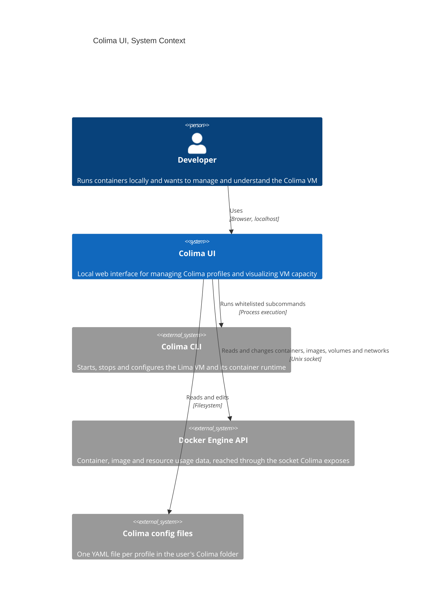
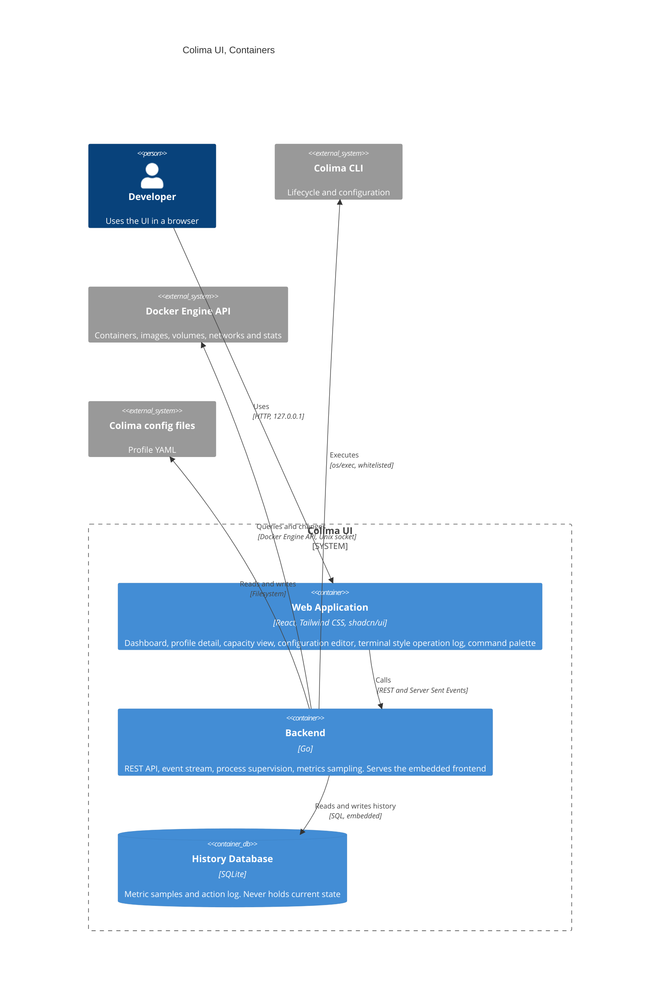
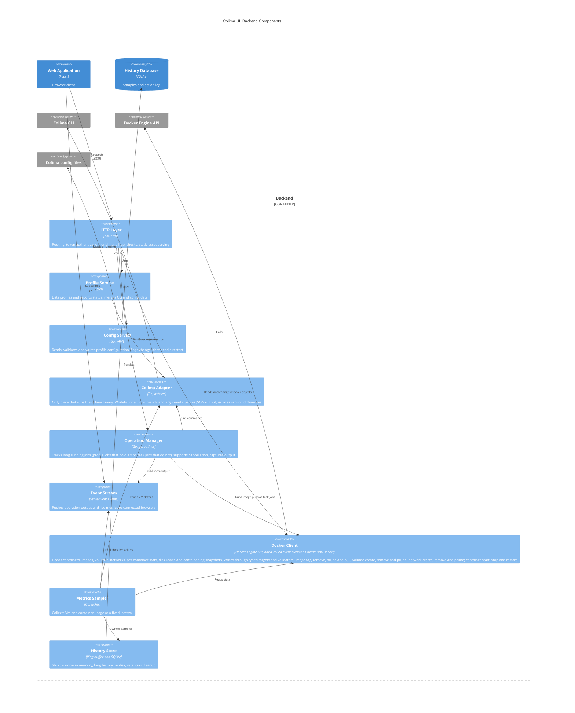

# Colima UI: C4 Architecture Documentation

Status: Draft 0.4, 26 November 2026. Adds the Docker write side (images, volumes, networks and container start, stop and restart), task jobs that hold no profile slot, the update, delete, Kubernetes and cache prune jobs, profile deletion guarded by Docker contents, the action log and its `_global` key, the responsive layout, and the matching flows, security rules and decisions. Draft 0.3 (23 November 2026) added the decisions on Colima versions, runtimes, metric history, profiles, platform and finished job output.
Scope: Levels 1 to 3 of the C4 model (Context, Containers, Components). Level 4 (code) is intentionally left out until the first implementation exists.

## 1. Purpose

Colima UI is a local web interface on top of Colima. Colima is a command line tool that runs a Lima virtual machine and a container runtime inside it. The UI has two goals. The first is to make the VM layer easier to operate: profiles, start, stop, restart, and configuration. The second is to make capacity and limits visible, so the user can see what the VM is allocated, what it actually uses, and which containers are responsible.

The tool runs only on the developer's own machine. It is not a hosted service and it has no multi user concerns.

## 2. Level 1: System Context

The developer opens the UI in a browser. The UI does not manage containers or VMs by itself. It delegates to Colima for the VM lifecycle and to the Docker Engine API for container and usage details, and for changes to containers, images, volumes and networks.



## 3. Level 2: Containers

In C4, a container is a separately running piece of the system, not a Docker container. Colima UI has three: the React single page application, the Go backend, and a SQLite database file. The backend serves the built frontend from embedded assets, so the whole product ships as one binary.



### Container responsibilities

| Container | Technology | Responsibility |
| --- | --- | --- |
| Web Application | React, Tailwind CSS, shadcn/ui (Base UI primitives), built to static files | Presents state, sends user intent to the API, shows streamed progress. Holds no business rules beyond input validation for convenience. |
| Backend | Go, standard library HTTP, a small hand-rolled Docker Engine API client | Owns every interaction with the machine. Validates requests, runs Colima commands, streams output, samples metrics, enforces security rules. |
| History Database | SQLite through a pure Go driver (modernc.org/sqlite), no cgo | Stores time series samples and an action log so history survives restarts. |

### Source of truth

Current state is always read live from Colima, the config files and the Docker API. The database is never used to answer "what is the state right now". This avoids drift when the user runs Colima from a terminal while the UI is open.

## 4. Level 3: Components of the Backend



### Component notes

The HTTP Layer is thin. It decodes requests, checks authentication, and hands off. It contains no Colima knowledge.

The Colima Adapter is the single choke point for process execution. Every subcommand is an explicit Go function with typed arguments, never a string assembled from user input. When Colima changes its output between versions, this is the only component that should need an update.

The Config Service treats the YAML files as the authority. It validates changes, shows which ones require a VM restart, and refuses to write while an operation is running on the same profile.

The Operation Manager serializes work per profile, so two starts or a start and a stop can never run at once on the same VM. Each job has an identifier, a status, captured output, and a context that cancels the child process. The jobs that hold the profile slot are start, stop, restart, create, update (`colima update`, running profiles only), delete and the four Kubernetes verbs. A second kind, the task job, holds no profile slot: the image pull (a Go function that streams from the Docker client) and the download cache clearing (`colima prune`, which belongs to no profile). Task jobs share the job table, output capture, cancellation and event publishing, but never block a start, stop, restart or configuration write and are not blocked by them. The limits are two pulls at a time and one identical reference per profile, and one cache prune at a time across the backend. A delete is refused while a task job runs on its profile, and a cache prune and the jobs that download assets (create, start, restart, Kubernetes start) refuse each other, both checks made under the manager's own lock so neither side slips past the other. Jobs that check a state before running (delete, Kubernetes, update) repeat the check inside the slot and fail closed.

The Docker write foundation gives every Docker route the same steps, in order: the profile gate (the profile exists, the VM is running, the runtime is Docker), an advisory busy check (it sees only this backend's own start, stop and restart jobs, not a terminal or a configuration write), a strict flat body (exact keys, a size limit, nothing nested), validation of every name, reference and value, one fixed typed Docker call whose errors map to fixed messages, and an action log row per attempt that reached Docker. Docker's own text is never sent to the browser, except the cleaned registry error of a failed pull, which answers the user's own request. The details are in `docs/api.md` section 1.3.

The action log records one row per job and per Docker write attempt: the profile, the action name (`start`, `delete`, `docker.volume.remove` and so on), the outcome and a short detail. The Operation Manager feeds it through an observer, and the Docker routes append their own row. A job that belongs to no profile (the cache prune) is stored under the reserved key `_global`, a name no profile can have; no route reads it yet.

The Metrics Sampler feeds the capacity view. It records what the VM is using and what each container is using. Allocated figures are not stored: the capacity view takes the limits from the profile and plots the recorded usage against them, which is what lets the UI show the gap between limit and reality.

### Frontend structure (proposed)

The React application is organized around five views: a dashboard of all profiles, a profile detail page, a capacity view with charts, a configuration editor, and an operation log panel that follows a running job. A command palette, opened with Cmd+K, gives keyboard access to every action. Server data is fetched through a query cache library, and live data arrives through one Server Sent Events connection.

### Frontend visual design

The interface targets developers, so the look is a dense, dark, terminal inspired style, built on Tailwind CSS and shadcn/ui. shadcn/ui components are copied into the repository instead of installed as a dependency, which keeps full control over every detail and avoids fighting a heavy component library. The Base UI primitives underneath (the shadcn/ui `base-nova` style) provide accessibility for dialogs, menus, and focus handling.

Theming is driven entirely by CSS variables, so a theme is one file. Dark is the default. The planned palettes are Catppuccin Mocha, Tokyo Night, Gruvbox, Nord, and Dracula, selectable by the user. A light theme is built from the start so that contrast and accessibility problems do not hide in a dark only design.

Typography pairs a monospace font for numbers, profile names, and any data (JetBrains Mono, Geist Mono, or IBM Plex Mono, all free) with a clean sans serif for labels and prose.

Layout favors compact tables over padded cards, status dots for state, and usage bars that resemble terminal meters. Interaction is keyboard first: shortcuts for start, stop, and restart, plus the command palette (the cmdk library).

Two specialized libraries cover the rich parts. The operation log uses xterm.js, so streamed Colima output renders exactly like a real terminal, colors included. The capacity charts use uPlot for fast live time series, with thin lines, no gradients, and subtle grid lines. Recharts is the fallback if uPlot proves too manual to style.

The layout uses the full window width with fluid padding instead of a fixed page width, and it adapts to narrow windows by one rule: tables hide their lower priority columns progressively as the window narrows (for example the image id and creation time), the header and tabs wrap, and dialogs keep a side gutter. A table scroll region is the last resort, not the first.

Retro component libraries such as NES.css or 98.css are deliberately avoided. The personality comes from theme and typography, while the layout stays conventional enough to be pleasant in daily use.

## 5. Key Flows

Starting a profile. The user clicks start. The browser posts to the API. The HTTP Layer authenticates and passes the request to the Operation Manager, which checks that no other job is running on that profile and asks the Colima Adapter to run the start command. Output lines are published through the Event Stream, and the browser renders them as they arrive. When the process exits, the job closes with a final status, the action is written to the log, and the dashboard refreshes its state from Colima.

Viewing capacity. The Metrics Sampler wakes on its interval, reads VM and container figures, writes them to the History Store, and publishes the latest values. The capacity view loads recent history over REST, then keeps itself current from the event stream.

Creating a profile. The user submits a name and basic settings. The route validates every value, refuses a name that already exists (in Colima's list or as a folder, in any letter case) and asks the Operation Manager for a `create` job, which runs `colima start` on the new name. From there it behaves like a start.

Deleting a profile. The user opens the delete dialog, which asks `GET /api/profiles/{name}/contents` for the number of Docker containers, images and volumes in the VM (counts only, three Docker reads, advisory). The user types the profile name as confirmation. The route checks the body, the busy state, that the profile exists, the confirmation and then the state: a running VM with the Docker runtime must hold nothing, a running VM on containerd or incus is allowed, a broken VM is always allowed without reading Docker, and a stopped, starting or unknown VM is refused. A refusal is a 409 `invalid_state` whose `details.reason` says why (`docker_not_empty`, `cannot_verify`, `task_running`) and a Docker read that fails answers 502. If everything allows it, the Operation Manager reserves the profile slot and the job reads the status and the Docker counts again inside the slot. If the state changed, the job ends as failed without running Colima and its action log row says `not run: ...`. Otherwise it runs `colima delete -p <name> --force`, plus `--data` when asked, streams its output, writes the action log row, and the profile leaves the list. History rows stay.

Changing a Docker object. The user, for example, removes an image from the Docker tab and confirms. The browser sends one request to the image route. The HTTP Layer authenticates it, the profile gate checks that the VM is running on the Docker runtime, and the busy check looks for a start, stop or restart job. The body and the image text are validated, and then the Docker Client makes its fixed calls: it counts the containers that use the image and refuses with a conflict when any does, otherwise it removes the tags it found, never forced, and reads the image again. The answer lists what Docker untagged and deleted, the action log gets a `docker.image.remove` row with the image text, and the browser refreshes the list. Prune routes follow the same path after a fixed confirmation text, and an image pull answers 202 and continues as a task job that streams its progress like any other job.

Editing configuration. The user changes CPU, memory or disk. The Config Service validates the values, writes the YAML, and returns a list of changes that need a restart. The UI shows that cost and offers a restart, which runs as a normal operation.

## 6. Security Boundaries

This application can control the VM and, through the Docker socket, effectively the machine, so the backend is the security perimeter.

The server binds to 127.0.0.1 only and never to all interfaces. Every API call requires a random token generated at startup. The HTTP Layer checks the Host and Origin headers to defend against DNS rebinding and cross site requests. There is no endpoint that accepts an arbitrary command, only the fixed set of operations the Colima Adapter exposes. Configuration values are validated against allowed ranges before they touch disk or a command line.

Destructive actions have more guards:

1. Typed confirmations. A profile delete needs the profile name, the Kubernetes reset and delete need a fixed text, the cache clearing and each Docker prune need their own fixed text. The server compares the text exactly and starts nothing without it.
2. State allowlists. A delete is allowed only in the states listed in the Profile deletion decision, Kubernetes controls only on a running profile with Kubernetes enabled, an update only on a running profile, and a Docker write only on a running VM with the Docker runtime. Anything else, and any read that cannot be made, is refused.
3. In-slot re-check. A route reads state outside the profile slot, so a delete, a Kubernetes job and an update repeat their checks inside the slot and fail closed without running Colima.
4. Counts only. The contents route returns numbers, never a container, image or volume name or id.
5. Typed Docker access. Docker routes take validated names and references, one fixed call each, never a forced delete, never registry credentials, and no Docker text in the answer. Image pull accepts public registries only and a tag or digest.
6. Truthful audit. The action log says what happened, including `not run:` rows for a refusal inside the slot and `changed=unknown` after a timeout.

## 7. Data Model (History Database)

```sql
CREATE TABLE metric_sample (
    id            INTEGER PRIMARY KEY,
    profile       TEXT    NOT NULL,
    taken_at      INTEGER NOT NULL,   -- unix seconds
    scope         TEXT    NOT NULL,   -- 'vm' or a container id
    cpu_percent   REAL,
    memory_bytes  INTEGER,
    disk_bytes    INTEGER
);
CREATE INDEX metric_sample_lookup ON metric_sample (profile, scope, taken_at);

-- Rollup of raw samples older than 24 hours, one row per minute.
CREATE TABLE metric_sample_1m (
    profile       TEXT    NOT NULL,
    scope         TEXT    NOT NULL,
    bucket_start  INTEGER NOT NULL,   -- unix seconds, multiple of 60
    cpu_percent   REAL,               -- average over the bucket
    memory_bytes  INTEGER,
    disk_bytes    INTEGER,
    samples       INTEGER NOT NULL,   -- raw samples folded into the bucket
    cpu_samples   INTEGER NOT NULL,   -- how many of them had a cpu value
    mem_samples   INTEGER NOT NULL,   -- ... a memory value
    disk_samples  INTEGER NOT NULL,   -- ... a disk value
    PRIMARY KEY (profile, scope, bucket_start)
) WITHOUT ROWID;

CREATE TABLE action_log (
    id          INTEGER PRIMARY KEY,
    profile     TEXT    NOT NULL,     -- '_global' for jobs that belong to no profile
    started_at  INTEGER NOT NULL,
    action      TEXT    NOT NULL,     -- 'start', 'stop', 'delete', 'docker.volume.remove', ...
    outcome     TEXT    NOT NULL,     -- 'success', 'failed', 'cancelled'
    detail      TEXT
);
CREATE INDEX action_log_recent ON action_log (profile, started_at DESC, id DESC);
```

The schema is created by embedded SQL migrations (`internal/store/migrations`). The version lives in `PRAGMA user_version`, and each migration runs in its own `BEGIN IMMEDIATE` transaction together with its version bump. Opening a database already at the current version writes nothing, and a database written by a newer program is refused (there are no down migrations; the file holds history only and can be deleted). The file is `<UserConfigDir>/colima-ui/history.db` (override with `COLIMA_UI_DATA_DIR`), the folder is mode 0700 and the file is created 0600. The database uses WAL, `busy_timeout` 5000, `synchronous` NORMAL, foreign keys on and incremental auto vacuum, with one writer connection and a pool of 4 readers.

Retention follows the decision in section 9 and is applied by a periodic cleanup (first run shortly after start, then hourly):

1. Raw samples older than now minus 24 hours (rounded down to a whole minute) are folded into `metric_sample_1m` with `ON CONFLICT DO NOTHING` and deleted, one hour of raw time per transaction with a pause between slices, so a rerun is a no-op and the writer is never held for long. A late raw sample for an already folded minute is merged into that bucket (weighted by the per-field counts) instead of being dropped.
2. `metric_sample_1m` rows older than 30 days are deleted in chunks of 5,000.
3. `action_log` keeps the newest 1,000 rows per profile. The decision does not cover the action log, so this cap is an addition that stops the table growing without bound. The `action_log_recent` index serves the "recent actions" query.
4. Free pages are returned with an incremental vacuum and the WAL is checkpointed.

Recent history is also held in memory: one ring of 17,280 slots (24 hours at 5 seconds) per (profile, scope), allocated lazily, dropped after 10 idle minutes and capped at 256 scopes. It is write-through and rehydrated from `metric_sample` when the store opens, so a query that starts within the last 24 hours is answered without touching the disk. Older ranges read the 1 minute table plus any unfolded raw rows from one snapshot and are averaged down to at most `maxPoints` (2,000 at most) by one shared function. The 1 minute tier stores averages, so short spikes older than 24 hours are not visible in charts.

## 8. Deployment

One Go binary containing the embedded React build. It runs as a normal process on the developer's machine, either started by hand or by a login item. It needs read access to the Colima config folder and access to the Docker socket. Packaging as a menu bar or desktop app (for example with Tauri) is possible later without changing the architecture.

## 9. Decisions

| Decision | Choice | Reason |
| --- | --- | --- |
| Backend language | Go | Same language as Colima, Lima and Docker. Strong process supervision and a single binary. |
| Frontend | React | Team preference and a large ecosystem for charts and data views. |
| Storage | SQLite, history only | Embedded, no server to run. Current state is never cached, which prevents drift. |
| Container data | Docker Engine API (small hand-rolled client over the Colima Unix socket, pinned to /v1.41), not CLI parsing | Stable, typed, documented. The Docker Go SDK would add about 20 modules and is pre-1.0 on its maintained path. |
| Colima data | CLI JSON output plus config files | Colima has no stable API, so access is isolated in one adapter. |
| Live updates | Server Sent Events | One way streaming is enough, simpler than WebSockets. |
| Styling | Tailwind CSS with shadcn/ui | Components live in the repo, so every detail can be restyled. Accessible Base UI primitives underneath. |
| Visual identity | Dark terminal style, themeable through CSS variables | Appeals to the developer audience. A palette is a single file swap, and a light theme ships too. |
| Operation log | xterm.js | Renders streamed command output, colors included, like a real terminal. |
| Charts | uPlot, Recharts as fallback | uPlot is small and fast for live time series. Recharts is easier to theme if needed. |
| Navigation | Command palette (cmdk) and shortcuts | Keyboard first interaction suits the audience and speeds up frequent actions. |
| Colima versions | Built and tested against Colima 0.10.x. The adapter detects the version with `colima version`, parses tolerantly, and keeps working on other versions | A version outside 0.10.x shows a warning in the UI and an unrecognised output shape returns a clear error. The tool never refuses to start because of the version. |
| Runtimes in the first release | Docker only. Profiles that use containerd, Incus or Kubernetes are listed and managed (start, stop, configuration) but show no container data | The Docker Client uses the Docker Engine API. Other runtimes are a later addition. |
| Metric history | Sample every 5 seconds. Keep raw samples for 24 hours, then 1 minute averages for 30 days, then delete. Not user configurable in the first release | Keeps the SQLite file small while showing recent detail and a month of trend. |
| Profiles | All profiles are listed and managed at launch, and every profile route carries the profile name | The dashboard is a table of profiles by design, so several profiles cost nothing extra. |
| Platform | macOS only in the first release | Socket and configuration folder discovery assume macOS. Linux is a later addition. |
| History database failure | A history database that cannot be opened, including one written by a newer version, stops the backend at startup with a clear message | The file holds history only and can be deleted, so failing fast is simpler than running without history. The same stance as a missing `colima` binary. |
| Observer fan-out | The Operation Manager calls three observers in order for every job: the action log recorder (bounded queue, own writer goroutine), the event stream (non-blocking publish) and a sampler refresh signal | Each observer is non-blocking, so a slow database or browser never stalls a job's output. A finished job also makes a start or stop show up in sampling within seconds. |
| Shutdown order | Event streams end first, then the HTTP server stops, then the sampler, the Operation Manager, the action log recorder and finally the History Store | An open stream would otherwise hold the HTTP shutdown for its whole timeout, and the recorder must drain after the manager so the last finished job is written before the store closes. |
| Finished job output | Kept in memory only. After a backend restart a finished job shows its action log summary and no output | Matches the API contract, which already treats output after a restart as unavailable. |
| Container logs | A read-only snapshot of the last 200 lines by default (at most 1000) per container, fetched on demand. No streaming and no follow mode | Container output can contain secrets, and a live stream needs bounds on followers and retained output. The snapshot keeps the backend stateless and bounded (64 KiB per frame, 4000 characters per line, 512 KiB per response). A follow mode can be added later on top of it. |
| Profile creation | Allowed from the UI, basic settings first (name, CPUs, memory, disk, root disk, runtime, VM type, architecture, mount type, Kubernetes). The route also takes the advanced settings (hostname, DNS servers and hosts, SSH agent, Rosetta, port forwarder, inotify, network address, mode and interface, CPU type); mounts and environment variables are accepted under strict validation (see the next row). Colima has no rename. Creation is a `create` job (a `colima start` on a new name) through the Operation Manager, refused when the name exists in any letter case. A failed creation can leave a half-created profile, which the user removes with the delete route (next row) | Creation is the first thing a new user needs. Reusing the job pipeline gives streamed output and an action log row for free. Colima accepts any start on an unknown name, so the route itself must refuse existing names or a create would silently rewrite a profile's settings. The operation slots are keyed by lowercase name because the default macOS filesystem treats `Dev` and `dev` as one folder. |
| Profile deletion | Allowed from the UI as a `delete` job (`colima delete -p <name> --force`, plus `--data` when the user asks for the runtime data to go too). `--force` is always passed so the process never waits for a prompt the UI cannot answer; the confirmation is the profile name typed in the dialog and sent as `confirm`. A VM is deleted only when it holds no Docker containers, images or volumes (issue #157; counts only, stopped containers included, read through the existing Docker client lists). An allowlist of states: a `broken` VM is always deletable and its Docker contents are not read (Colima cannot be asked about a broken VM; this is how a damaged profile is cleaned up, and the typed-name confirmation is the guard); a `running` VM is allowed when all three counts are zero or its runtime is containerd or incus (only `docker`, `containerd` and `incus`, optionally with `+k3s`, are recognised; an empty or unknown runtime, or a list and status that disagree, fail closed as 502), and refused with 409 `invalid_state` and `details.reason` `docker_not_empty` (with the counts) otherwise, or 502 `docker_unavailable` when Docker cannot be read (fail closed); a `stopped` VM is refused with `details.reason` `cannot_verify` because its Docker data cannot be read, so the user starts it, empties it and deletes it; starting or unknown states are refused, and so is any delete while a task job such as an image pull runs on the profile (`details.reason` `task_running`). The status and the count are read again inside the profile slot right before the command runs, and the count fails closed there too (a refused re-check is a failed job that never ran colima, and its action log row names the reason: `not run: docker not empty`, `not run: could not check docker contents`, `not run: profile is stopped, docker contents cannot be checked` or `not run: profile state did not allow deleting`). `GET /api/profiles/{name}/contents` gives the UI the same counts for the dialog (three Docker calls: containers of every state, images, volumes; intermediate layers and build cache are not counted, `colima delete` destroys them too), and the profile must exist as a Colima listing or a real directory in Colima's folder (`default` is not special). History rows stay | `colima delete` is irreversible, and a VM that still holds containers, images or volumes would lose them with it. The in-slot re-check closes the window left by the slow `colima list` and Docker reads, but stays best effort against `colima` runs in a terminal. Residual race: the count and `colima delete` are not atomic, so a container created (for example from a terminal) after the in-slot count and before the VM is removed is deleted with it; a one-shot check cannot close that, and the owner accepted it. A stray file in Colima's folder must not pass for a profile. |
| Kubernetes cluster control | Start, stop, reset and delete of the cluster are four fixed `colima kubernetes <verb>` jobs through the Operation Manager, allowed only on a running profile whose configuration has `kubernetes.enabled` true (read through the Config Service, never by parsing YAML in a route). The cluster's own state is not the gate: `colima status` reports `kubernetes: false` for a stopped cluster, which would make Start unreachable. Hand-editing the YAML while the VM runs can make the flag drift from the real cluster (true: Start may run on a VM booted without Kubernetes; false: a running cluster cannot be stopped or deleted from the UI). The UI never enables Kubernetes through them. Reset and delete need an exact confirmation text, and a cancelled or failed one can leave the cluster half done | These are the destructive cluster operations Colima offers. The job repeats the running and enabled checks inside the profile slot and fails closed (a refusal is a failed job that never runs colima, like a refused delete), because the route's reads happen outside the slot. |
| Profile creation: mounts, environment and exclusions | Mounts and environment variables are accepted on creation. A mount is an absolute, clean path with no comma, quote, colon, brace, dollar sign or control character, at most 16, no duplicates, existing and a directory on the host at request time, with symlinks resolved and the resolved path passed to Colima. The root, the home folder and the folders above it are refused when writable (decided by file identity, so firmlinks and case variants are caught) and allowed read-only. Environment variables are `KEY=value` with a `[A-Za-z_][A-Za-z0-9_]*` key, a value up to 4 KiB without NUL, at most 32; a value is refused when it ends in a double quote or combines `=` with a comma, quote or line break, because pflag would parse it differently. Neither is ever logged or repeated in an error. Not supported by design: `--disk-image`, `--force-disk-image`, `--k3s-arg`, `--edit`, `--editor`, `--foreground`, `--template`, `--save-config` and `--downloader` | A mount exposes a host folder to the VM and every container in it, and a disk image is an arbitrary file, so the conservative choice ships first and can be widened later. Colima parses `--mount` as a CSV list, so a comma in a path would add a second mount. The Config Service and the adapter apply the same syntax rules, pinned together by a parity test |
| Docker manager scope and rules | The Docker tab manages images (tag, inspect, remove, prune, pull), volumes (create, inspect, remove, prune) and networks (bridge only: create, inspect, remove, prune). A prune needs its own fixed confirmation string (`delete-unused-volumes`, `delete-unused-networks`, `delete-unused-images`). A delete is never forced: no route sends `force`. Inspect is a read, with no busy check and no action log row. Removing an object that is in use or protected is refused with `409 conflict`. A pull accepts public registries only and a reference with a tag or a digest, never an implicit `latest`, and takes no credentials, platform or other option | Pruning and removing cannot be undone, and volumes can hold the only copy of data, so each destructive step needs an explicit confirmation and Docker is never asked to override its own safety checks. Prune removes named volumes too (Docker API v1.41 behaviour), which is why its text is distinct per resource. Private registries would mean storing credentials, which is deliberately out of scope. |
| Container actions | Start, stop and restart of one container only. The route accepts the full 64 character id only, never a name, a short id or a prefix, because Docker resolves an id first, then a name, then a prefix, and a container named like another one's id could take its place. The body is empty. Docker's answer that the container is already in the state is a success with `changed:false`. A Docker 400 on start (resource limits that no longer fit) maps to `409 conflict`. Remove, pause, kill, exec, a custom grace period and bulk actions are out of scope | The three actions are reversible and cover the daily need. Anything destructive or interactive would need its own guards and was not asked for. Mapping the 304 and the 400 to fixed answers keeps Docker's text out of the browser. |
| Update runtime | `colima update` runs as an `update` job on a running profile only, holds the profile slot, can be cancelled and writes an `update` action log row. A profile that is not running gets `409 invalid_state` and nothing starts | The command refreshes the container runtime inside a running VM, so there is nothing to update in a stopped one, and sharing the slot keeps it from overlapping a start or stop. |
| SSH config view | `colima ssh-config` is shown as a read: the raw text and the parsed key and value lines, fetched once when the dialog opens and never polled, with no busy check and no action log row. The text holds the identity file path and no key material. A profile that is not running is not rejected up front; if Colima refuses, the route answers `409 invalid_state` | The data is for IDE remote access and `scp`, it changes only when the VM does, and it changes nothing. Letting Colima decide avoids a second opinion about when it can answer. |
| Clearing the download cache | `colima prune --force` (plus `--all` when asked, to include Lima's cache) runs as a global task job with the action `cache-prune`, no profile and no slot. It needs the typed text `delete-cached-assets`. At most one runs at a time, and it and the jobs that download assets (create, start, restart, Kubernetes start) refuse each other with `409 invalid_state` (`details.reason` `assets_in_use` or `cache_prune_running`). A cancelled one can leave a partial cache, which the next create or start refills | The cache is shared by every profile and Colima removes the folder whatever is using it, so the two sides refuse each other under the manager's lock instead of relying on open files. The only cost of a clear is a new download. The action log row is stored under the reserved key `_global`. |
| Error convention | A refusal that depends on the current state reuses `409 invalid_state` and puts the cause in `details.reason` (`docker_not_empty`, `cannot_verify`, `task_running`, `kubernetes_not_enabled`, `cache_prune_running`, `assets_in_use`) together with `details.status` where it applies. No new error code is added for a state refusal | Clients already switch on `code`, so a new cause is additive and a route never needs a new code. The reason keys are stable strings, the message is for people. |
| Audit truthfulness | The action log never claims more than is known. A refusal that happens inside the profile slot is a failed job whose row starts with `not run:` and names the reason, never a Colima exit status. A Docker write whose outcome is unknown (socket failure, Docker 5xx, timeout) is recorded as failed, and a container action row then says `changed=unknown`, because the change may or may not have been applied. A request refused before Docker is contacted writes no row, so a hostile name never lands in the log | The log is the record of what the UI did to the machine, so a guess presented as a fact would mislead the next person who reads it. |
| Responsive layout | The interface uses the full window width with fluid padding. Table columns of lower priority hide progressively as the window narrows, the header and tabs wrap, dialogs keep a side gutter, and a scroll region around a table is the last resort | A fixed page width wasted space on large windows and broke on small ones. Hiding the least useful column first keeps the row name and its actions visible at every width. |

## 10. Open Questions

The themes question is answered: the first release ships Catppuccin Mocha, Tokyo Night, Gruvbox, Nord, Dracula and a light theme, the theme system follows the operating system setting by default, and each palette meets the contrast test in `web/src/styles/themes/contrast.test.ts`.

Two questions stay open and are on hold, with no work planned:

1. Distribution. How the binary reaches other people (release builds, signing, an install route) is undecided.
2. A macOS app wrapper. Packaging as a menu bar or desktop app (section 8) is possible without changing the architecture, and is not started.
